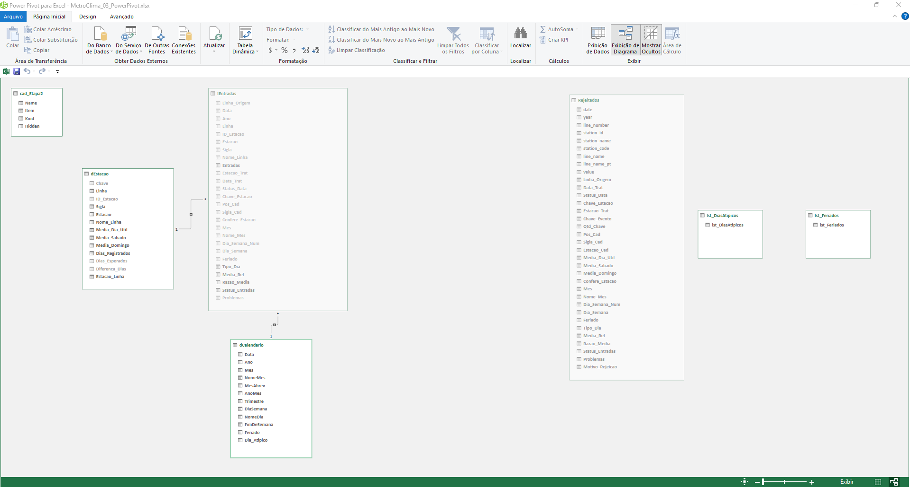

# Modelo relacional -- MetroClima_03_PowerPivot.xlsx

Origem dos dados: MA2026-entrega-parcial/02-powerquery/MetroClima_02_PowerQuery.xlsx
(parâmetro pArquivoEtapa2). Nenhum dado é digitado nesta etapa.

## Tabelas
| Tabela      | Tipo      | Grão (1 linha =)         | Chave                   | Linhas |
|-------------|-----------|--------------------------|-------------------------|--------|
| fEntradas   | fato      | estação-linha em um dia   | (Chave_Estacao, Data)   | 11946  |
| dEstacao    | dimensão  | estação em uma linha     | Chave                   | 66     |
| dCalendario | dimensão  | dia (01/01 a 30/06/2026) | Data                    | 181    |
| Rejeitados  | auditoria | linha bruta descartada   | --                      | 0      |

## Relacionamentos (todos ativos, N:1, filtro em direção única)
| #  | Lado N (FK)              | Lado 1 (PK)       |
|----|--------------------------|-------------------|
| R1 | fEntradas[Chave_Estacao] | dEstacao[Chave]   |
| R2 | fEntradas[Data]          | dCalendario[Data] |

dCalendario marcada como Tabela de Datas (coluna Data).
Previsto: dClima (Data) e R3 fEntradas[Data] -> dClima[Data] na etapa da chuva.

## Decisões
- Chave de dEstacao = Linha + ID_Estacao: 4 estações existem em duas linhas.
- "Esperado" = média da estação por tipo de dia (dEstacao); não há fMetas.
- 02/01/2026 marcado em dCalendario[Dia_Atipico] (58 estações em queda; pendente).

