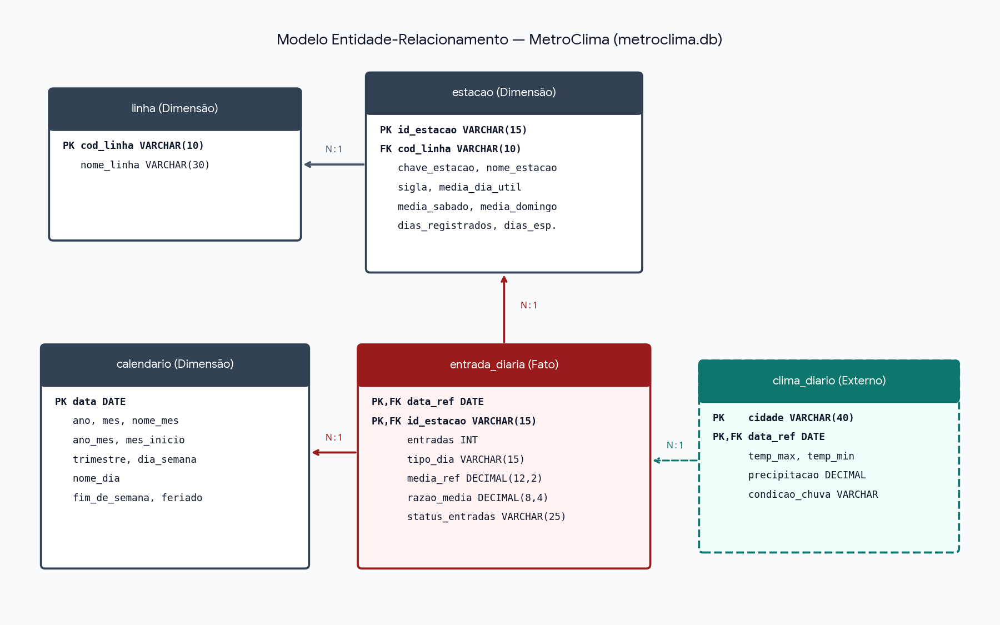

# Modelo Relacional — `metroclima.db` (SQLite)

**Origem:** `MetroClima_02_PowerQuery.xlsx` / `MetroClima_03_PowerPivot.xlsx`, exportada em `csv/` (`dEstacao.csv`, `fEntradas.csv`). Nenhum dado é digitado manualmente.

**Ordem de execução dos scripts:**
1. `metroclima_ddl.sql`
2. Importação dos CSVs (`dEstacao.csv` -> `stg_estacao`; `fEntradas.csv` -> `stg_entradas`)
3. `metroclima_carga.sql`
4. `metroclima_clima_SIMULADO.sql` (provisório até a Etapa 6 - API Open-Meteo)
5. `metroclima_views.sql`
6. `metroclima_consultas.sql` e `metroclima_conferencia.sql`

## Tabelas do Modelo Físico

| Tabela | Papel | Grão (1 linha =) | Chave Primária (PK) | Chaves Estrangeiras (FK) | Linhas |
| :--- | :--- | :--- | :--- | :--- | :---: |
| `linha` | Dimensão | Uma linha do Metrô (1, 2, 3, 15) | `cod_linha` | — | 4 |
| `estacao` | Dimensão | Uma estação cadastrada | `id_estacao` | `cod_linha` | 66 |
| `calendario` | Dimensão | Um dia (01/01 a 30/06/2026) | `data` | — | 181 |
| `entrada_diaria` | Fato | Registro de uma estação em um dia | `(data_ref, id_estacao)` | `data_ref`, `id_estacao` | 11.946 |
| `clima_diario` | Externa | Clima diário em São Paulo | `(cidade, data_ref)` | `data_ref` | 181 |

## Camada Analítica (Views para o Power BI - Etapa 7)
* `dim_estacao` (66 linhas)
* `dim_tempo` (181 linhas)
* `dim_clima` (181 linhas)
* `fato_entradas` (11.946 linhas no grão estação x dia)

