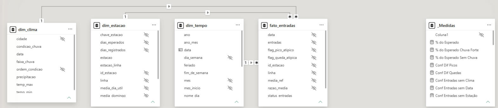

# Modelo do Power BI – MetroClima_Dashboard.pbix

**Fonte única:** `MA2026-entrega-final/05-sql/metroclima.db` (SQLite), via ODBC (driver *SQLite3 ODBC Driver* 64 bits, DSN de usuário `metroclima`, parâmetro `pConexaoODBC`). Modo **Importar**. Nenhum dado digitado no Power BI.

## Tabelas

| Tabela (= view) | Papel | Grão (1 linha =) | Chave | Linhas | Equivalente na Etapa III |
|---|---|---|---|---:|---|
| `fato_entradas` | Fato | uma estação em um dia | (`id_estacao`, `data`) | 11.946 | `fEntradas` |
| `dim_estacao` | Dimensão | uma estação em uma linha | `id_estacao` | 66 | `dEstacao` |
| `dim_tempo` | Dimensão (tabela de datas) | um dia (01/01 a 30/06/2026) | `data` | 181 | `dCalendario` |
| `dim_clima` | Dimensão externa (SIMULADA) | um dia em São Paulo | `data` | 181 | `dClima` (reservada) |
| `_Medidas` | Só medidas | – | – | – | – |

## Relacionamentos (todos ativos, Muitos para um, filtro em direção única)

| Id | De (lado N, fato) | Para (lado 1, dimensão) | Etapa III |
|---|---|---|---|
| R1 | `fato_entradas[id_estacao]` | `dim_estacao[id_estacao]` | R1 (por `Chave_Estacao`) |
| R2 | `fato_entradas[data]` | `dim_tempo[data]` | R2 |
| R3 | `fato_entradas[data]` | `dim_clima[data]` | R3 previsto ("etapa da chuva") |

**Não** existe relação `dim_clima[data]` – `dim_tempo[data]`: criaria dois caminhos de `dim_tempo` até a fato e uma relação ficaria inativa. A precipitação acompanha os filtros de mês e linha pelas medidas com `TREATAS` (pasta 05 Clima).

## Correspondência de nomes: Etapa III → banco → Power BI

| Etapa III (Power Pivot) | View do banco | Tabela/coluna no Power BI |
|---|---|---|
| `fEntradas[Entradas]` | `fato_entradas.entradas` | `fato_entradas[entradas]` |
| `fEntradas[Data]` | `fato_entradas.data` | `fato_entradas[data]` |
| `fEntradas[Chave_Estacao]` | `fato_entradas.id_estacao` | `fato_entradas[id_estacao]` |
| `fEntradas[Tipo_Dia]`, `[Media_Ref]`, `[Razao_Media]`, `[Status_Entradas]` | `.tipo_dia`, `.media_ref`, `.razao_media`, `.status_entradas` | idem |
| – | `.flag_queda_atipica`, `.flag_pico_atipico` | idem (ocultas; usadas nas medidas) |
| `dEstacao[Chave]`, `[Estacao]`, `[Nome_Linha]` | `dim_estacao.chave_estacao`, `.estacao`, `.nome_linha` | `dim_estacao[...]` |
| `dCalendario[Data]`, `[NomeMes]`, `[Mes]` | `dim_tempo.data`, `.nome_mes`, `.mes` | `dim_tempo[...]` |
| `dClima` (reservada) | `dim_clima` (de `clima_diario`) | `dim_clima[data]`, `[precipitacao]`, `[condicao_chuva]`, + `[faixa_chuva]` (regra da C4) |

## Decisões

- **Esperado = `SUM(media_ref)`**, a referência gravada pela Etapa II no banco (mesma regra da C2). A fórmula da Etapa III com `SWITCH` sobre as médias de `dEstacao` dá 339.840.819, praticamente igual ao realizado, e não reproduz a C2. Por isso foi trocada.
- **R3 por `data`** (e não por chave `cidade|data`): todas as estações ficam em São Paulo e a C3/C4 também filtram `cidade = 'São Paulo'`. `[Conf PK Duplicada]` acusa se, na Etapa 6, a API trouxer uma segunda cidade.
- `faixa_chuva` criada no Power Query com a mesma regra `CASE` da C4. `ordem_condicao` serve só para ordenar `condicao_chuva` (Sem Chuva → Chuva Leve → Chuva Forte).
- Ranking com `DENSE` (empates na mesma posição); a C1 desempata pelo id da estação.
- Sem mapa: as estações não têm latitude e longitude no banco.

